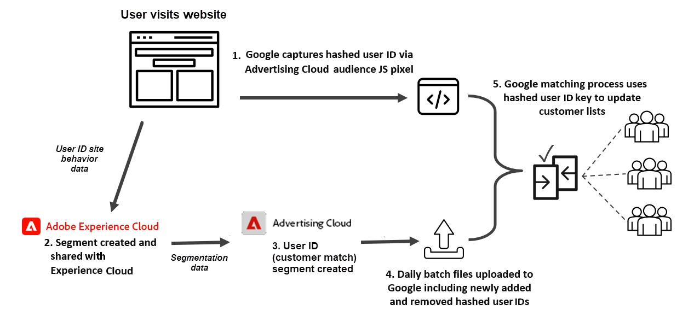

# Intégrations d’Adobe Advertising avec Adobe Analytics

Vous pouvez intégrer Adobe Advertising à Analytics comme suit.

## Échanger des données entre [!DNL Analytics] et Adobe Advertising

### Extraction de [!DNL Analytics] données dans Adobe Advertising

Avec [[!DNL Adobe] [!DNL Analytics for Advertising]](/help/integrations/analytics/overview.md),[!DNL Search, Social, & Commerce] et l’extraction DSP :

* **[!DNL Analytics]segments :** métadonnées, données hiérarchiques et données d’audience uniques pour tous les segments d’un annonceur ou d’une agence créés dans [!DNL Analytics] et publiés sur Adobe CX Enterprise.

* **[!DNL Analytics]mesures d’engagement du site**

* **[!DNL Analytics]mesures standard, personnalisées et réservées**

### Envoyer les données Adobe Advertising à [!DNL Analytics]

* **Mesures de trafic d’Adobe Advertising**

* **Dimensions d’Adobe Advertising**

>[!NOTE]
>
>Pour [!DNL Search, Social, & Commerce], cette fonctionnalité est prise en charge pour la plupart des réseaux publicitaires et des types de campagne. Pour plus d&#39;informations, voir « Inventaire pris en charge » dans le Guide [!DNL Search, Social, & Commerce].<!-- add link when that's published in ExL -->

### Utiliser [!DNL Analytics] segments pour créer [!DNL Google Ads] audiences {#audience-manager-google-audiences}

*Publicitaires inscrits avec [!DNL Advertising Search, Social, & Commerce] uniquement*

<!-- Verify all -->

Dans [!DNL Search, Social, & Commerce], vous pouvez créer [!DNL Google Ads] audiences de correspondance client Google à partir des ID utilisateur à l’aide de vos segments [!DNL Analytics] existants. Cela inclut les segments Adobe Analytics publiés sur Adobe CX Enterprise et les segments créés à l’aide du Adobe CX Enterprise [!DNL Audience Library]. Pour plus d’informations, voir « [Créer [!DNL Google Ads] des audiences de correspondance client à partir de [!DNL Adobe] audiences](/help/search-social-commerce/targeting/audiences/audience-manage.md#audience-adobe-create) ».

[Les audiences de correspondance client à partir des ID utilisateur](https://support.google.com/google-ads/answer/9199250) fonctionnent comme des audiences basées sur des balises de site web, mais un ID non PII est attribué à des membres d’audience uniques pour des avantages distincts par rapport aux audiences de correspondance client standard et basées sur des balises de site web.

Pour créer les identifiants d’utilisateur nécessaires, vous devez utiliser une balise Adobe Advertising JavaScript <!-- with a user ID parameter --> sur vos sites web. Pour plus d’informations, contactez l’équipe chargée de votre compte Adobe.

Une fois les audiences créées, vous pouvez les utiliser dans les campagnes [!DNL Google Ads] en tant que [cibles ou exclusions au niveau de la campagne ou du groupe publicitaire](#audience-manager-targets).

### Utiliser [!DNL Analytics] segments pour cibler ou exclure des publicités {#analytics-targets}

* (Publicitaires inscrits avec [!DNL Search, Social, & Commerce]) Vous pouvez utiliser toutes les audiences [!DNL Google Ads] qui ont été [créées à l’aide de [!DNL Analytics] segments](#audience-manager-google-audiences) comme cibles ou exclusions au niveau de la campagne ou du groupe publicitaire dans vos campagnes [!DNL Google Ads].

* (Annonceurs avec DSP) Vous pouvez utiliser vos segments [!DNL Analytics] existants en tant que cibles pour vos emplacements publicitaires. Vous pouvez éventuellement inclure les segments dans des audiences réutilisables, que vous pouvez utiliser comme cibles ou exclusions pour plusieurs emplacements.

* (Annonceurs avec Advertising Creative) Vous pouvez utiliser vos segments [!DNL Analytics] existants en tant que cibles pour des contenus publicitaires spécifiques dans vos expériences publicitaires.
