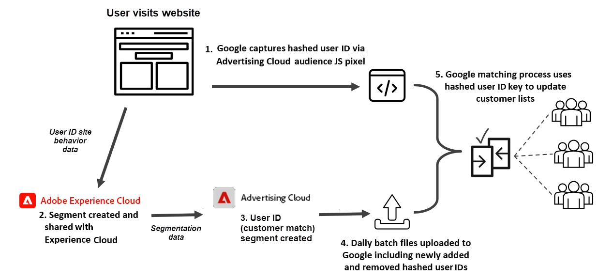

# Intégrations d’Adobe Advertising à Adobe Audience Manager

Vous pouvez intégrer Adobe Advertising à Audience Manager comme suit.

## Synchroniser Audience Manager et d’autres segments [!DNL Adobe] pour le ciblage publicitaire

[!DNL Search, Social, & Commerce] et DSP peuvent extraire des métadonnées, des données hiérarchiques et des données d’audience uniques pour toutes les audiences Audience Manager d’un annonceur ou d’une agence et les autres audiences [!DNL Adobe]. Cette connexion unique n’est disponible que pour les marketeurs qui utilisent Adobe Advertising. Voir « [Importer des segments Adobe Audience Manager pour le ciblage publicitaire](/help/integrations/audience-manager/import-audiences.md) ».

### Utiliser Audience Manager et d’autres segments [!DNL Adobe] pour créer [!DNL Google Ads] audiences {#audience-manager-google-audiences}

*Publicitaires inscrits avec [!DNL Advertising Search, Social, & Commerce] uniquement*

Dans [!DNL Search, Social, & Commerce], vous pouvez créer [!DNL Google Ads] audiences de correspondance client à partir des ID utilisateur à l’aide de vos segments Audience Manager existants qui ont [!UICONTROL Adobe Media Optimizer (HTTP)] et [!UICONTROL Adobe Media Optimizer Batch Destination] comme destinations. ([!DNL Media Optimizer] est un ancien nom pour [!DNL Search, Social, & Commerce].) Cela inclut les segments Adobe Analytics publiés sur Adobe CX Enterprise et les segments créés à l’aide du Adobe CX Enterprise [!DNL Audience Library]. Pour plus d’informations, voir « [Créer [!DNL Google Ads] des audiences de correspondance client à partir de [!DNL Adobe] audiences](/help/search-social-commerce/targeting/audiences/audience-manage.md#audience-adobe-create) ».

[Les audiences de correspondance client à partir des ID utilisateur](https://support.google.com/google-ads/answer/9199250) fonctionnent comme des audiences basées sur des balises de site web, mais un ID non PII est attribué à des membres d’audience uniques pour des avantages distincts par rapport aux audiences de correspondance client standard et basées sur des balises de site web.

Pour créer les identifiants d’utilisateur nécessaires, vous devez utiliser une balise Adobe Advertising JavaScript <!-- with a user ID parameter --> sur vos sites web. Pour plus d’informations, contactez l’équipe chargée de votre compte Adobe.

Une fois les audiences créées, vous pouvez les utiliser dans les campagnes [!DNL Google Ads] en tant que [cibles ou exclusions au niveau de la campagne ou du groupe publicitaire](#audience-manager-targets).

### Utiliser Audience Manager et d’autres segments [!DNL Adobe] pour cibler ou exclure les publicités {#audience-manager-targets}

* (Publicitaires inscrits avec [!DNL Search, Social, & Commerce]) Vous pouvez utiliser toutes les audiences [!DNL Google Ads] qui ont été [créées à l’aide de [!DNL Adobe] segments](#audience-manager-google-audiences) comme cibles ou exclusions au niveau de la campagne ou du groupe publicitaire dans vos campagnes [!DNL Google Ads].

* (Annonceurs avec DSP) Vous pouvez utiliser vos segments [!DNL Adobe] existants en tant que cibles pour vos emplacements publicitaires. Vous pouvez éventuellement inclure les segments dans des audiences réutilisables, que vous pouvez utiliser comme cibles ou exclusions pour plusieurs emplacements.

* (Annonceurs avec Advertising Creative) Vous pouvez utiliser vos segments [!DNL Adobe] existants en tant que cibles pour des contenus publicitaires spécifiques dans vos expériences publicitaires.

>[!NOTE]
>
>Pour plus d’informations sur la création d’audiences dans les interfaces Audience Manager et Adobe CX Enterprise [!DNL Audience Library], ainsi que pour des cas d’utilisation courants pour différents types d’audiences, consultez la section « [Options de création d’audience](https://experienceleague.adobe.com/docs/experience-cloud-kcs/kbarticles/KA-16471.html) ».

## Envoi de données d’exposition aux médias DSP vers Audience Manager

*Annonceurs avec DSP uniquement*

Les clients DSP avec Adobe Audience Manager peuvent capturer des données de campagnes publicitaires à l’aide d’appels de pixels vers Audience Manager. Vous pouvez ensuite utiliser les données de la campagne pour créer des caractéristiques basées sur des règles, que vous pouvez utiliser pour définir de nouveaux segments afin d’activer divers cas d’utilisation de DSP, tels qu’une segmentation plus avancée, la gestion des fréquences, les analyses marketing et les informations sur les rapports.

Pour plus d’informations, voir « [Présentation de l’envoi de données d’exposition aux médias DSP vers Adobe Audience Manager](/help/integrations/audience-manager/media-data-integration/overview.md) ».

## Obtenez des informations plus riches sur l’activité du site avec Audience Analytics

Les clients Adobe Advertising avec [[!DNL Adobe Audience Analytics]](https://experienceleague.adobe.com/docs/analytics/integration/audience-analytics/mc-audiences-aam.html) peuvent envoyer à la fois des données suivies par Adobe Advertising et des segments Audience Manager à [!DNL Analytics] pour obtenir des informations enrichies sur l’activité du site.

Pour plus d’informations, voir « [[!DNL Adobe Audience Analytics]  pour les clients Adobe Advertising](/help/integrations/audience-manager/audience-analytics.md) ».
