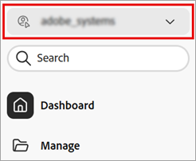

# Afficher les données pour un autre annonceur

*Utilisateurs et utilisatrices qui gèrent plusieurs comptes d’annonceurs uniquement*

## (Nouvelle interface utilisateur) Afficher les données d’un autre annonceur

1. Si le panneau de navigation de gauche est réduit, cliquez sur  pour le développer.

1. Au-dessus du champ de recherche dans le panneau de navigation de gauche, ouvrez la liste des annonceurs et sélectionnez l’annonceur.

   Vous pouvez effectuer une recherche dans la liste pour localiser un annonceur. La liste affiche l’annonceur actuellement sélectionné.

   

>[!NOTE]
>
>Le changement d’annonceur est désactivé dans certaines vues détaillées, y compris les détails du portfolio et les détails de la simulation. Revenez à la vue de liste correspondante pour sélectionner un autre annonceur.

## (interface utilisateur héritée) Afficher les données d’un autre annonceur

*Gestionnaire de compte d’agence, [!DNL Adobe] gestionnaire de compte et rôles utilisateur d’administrateur uniquement*

* Dans la liste des annonceurs en haut à droite de n’importe quelle page, sélectionnez l’annonceur.
